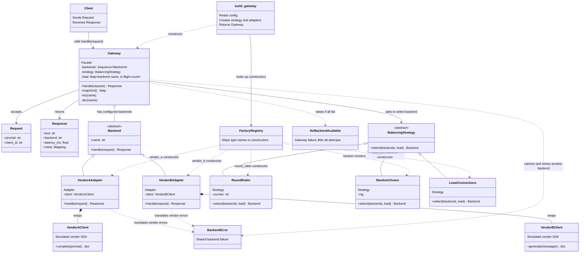
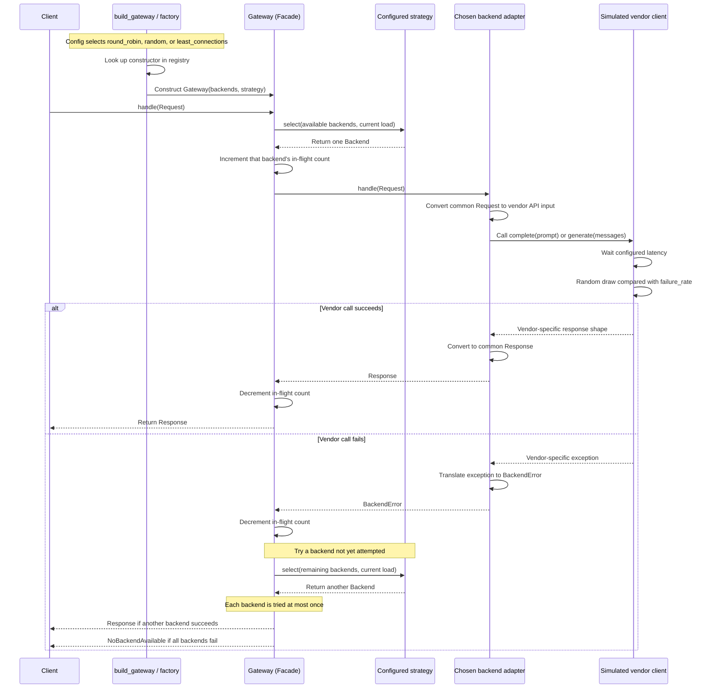

# Architecture and design patterns

This document describes the Phase 1 gateway. The simulated vendor clients stand in for real vendor SDKs; they do not make network requests or generate real LLM responses.

## Class and relationship diagram

## Request flow diagram

Time moves from top to bottom. Solid arrows show calls or messages; dashed arrows show returned values or errors.

## Arrow key for the class diagram

- `-->` is a directed interaction or use. For example, the client calls the gateway.
- `<|--` is inheritance or implementation. The hollow triangle points to the parent abstraction: `VendorAAdapter` implements `Backend`.
- `o--` is aggregation: the gateway holds references to backend objects supplied to it.
- `*--` is composition: each adapter creates and holds its vendor client.
- `..>` is a dashed dependency, such as translating to or raising an error type.

In the sequence diagram, `->>` is a call or outgoing message and `-->>` is a return. The `alt` block shows the success and failure paths.

## Pattern and class roles

| Pattern or type | Classes | What it does |
|---|---|---|
| Adapter | `VendorAAdapter`, `VendorBAdapter` | Translates the shared `Backend` request and response contract to and from each vendor API. |
| Strategy | `RoundRobin`, `RandomChoice`, `LeastConnections` | Implements a backend selection rule. The factory configures which strategy the gateway uses; that strategy selects a backend for each request. |
| Facade | `Gateway` | Gives callers one `handle(request)` entry point and coordinates backend selection, load tracking, and failover. |
| Registry-based factory | `build_gateway`, `_BACKENDS`, `_STRATEGIES` | Looks up configured names and constructs the matching adapters and strategy. This is registry-based construction, not the classic GoF Factory Method with subclass-overridden creation methods. |

`Request` and `Response` are the common data types. `Backend` and `BalancingStrategy` are abstract contracts. `BackendError` is the normalized backend failure; `NoBackendAvailable` reports that all configured backends failed for the request. `VendorAClient` and `VendorBClient` simulate incompatible third-party SDK interfaces.
