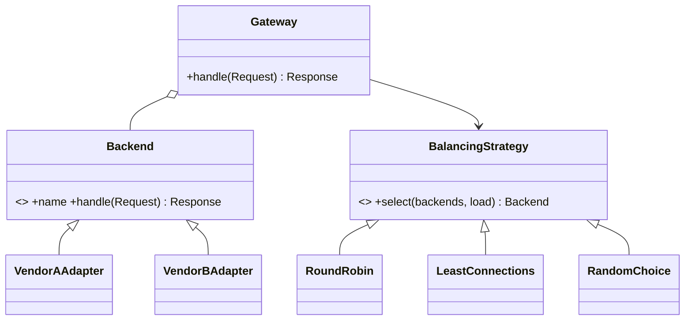

# Lab 1: AI Inference Gateway (core)

A gateway that spreads requests across several LLM backends. Backends are
simulated (latency and random failures), so benchmark numbers describe the
strategies, not real LLM performance.

## SOLID principles applied (3)

| Principle | Where | Evidence |
|---|---|---|
| **S** Single Responsibility | `Gateway` orchestrates only; `strategies.py` only chooses; adapters only translate; `factory.py` only constructs | Each class has one reason to change |
| **O** Open/Closed | New algorithm or backend = new class + `register_*` call | `test_new_strategy_needs_no_core_change` adds a strategy without editing any existing module |
| **D** Dependency Inversion | `Gateway.__init__(backends: Sequence[Backend], strategy: BalancingStrategy)` | `gateway.py` imports no concrete backend or strategy; only `factory.py` knows concretes |

Violation vs. fix (for the report): a Gateway with
`if strategy == "round_robin": ... elif strategy == "least_connections": ...`
violates O and S; replacing the chain with the `BalancingStrategy` abstraction
fixes both.

## Design patterns (4)

| Pattern | Class(es) | Problem it solves |
|---|---|---|
| Strategy | `RoundRobin`, `LeastConnections`, `RandomChoice` | Swap balancing algorithms at runtime and compare them |
| Adapter | `VendorAAdapter`, `VendorBAdapter` | Two vendor SDKs with incompatible APIs behind one `Backend` contract |
| Factory (registry) | `build_gateway`, `register_*` | Config-driven wiring without `if/else` on types |
| Facade | `Gateway.handle()` | One simple entry point hiding selection, load tracking and failover |

## Concurrency in Lab 1
- `RoundRobin` counter and `Gateway` load map are shared mutable state, each protected by a `threading.Lock`.
- Tests: balanced distribution and load returning to zero under 16 threads.

## Class diagram



## Benchmark (600 requests, 24 threads, backends 10/30/80 ms)

| Strategy | req/s | mean ms | p99 ms |
|---|---|---|---|
| round_robin | 568 | 40.2 | 80.3 |
| random | 546 | 41.6 | 80.3 |
| least_connections | 1061 | 21.2 | 80.2 |

Least-connections sends more traffic to faster backends (408/136/56), nearly
doubling throughput and halving mean latency. p99 is unchanged because some
requests still land on the slowest backend. Single run; repeat before quoting.

## Run
```
python3 -m unittest discover -s tests -v
python3 bench.py
```

## Planned for later labs (not built yet)
Circuit breaker (State), Retry/Timeout (Decorator), rate limiter and cache
(Chain of Responsibility), metrics (Observer). Adapt to what each lab requires.
