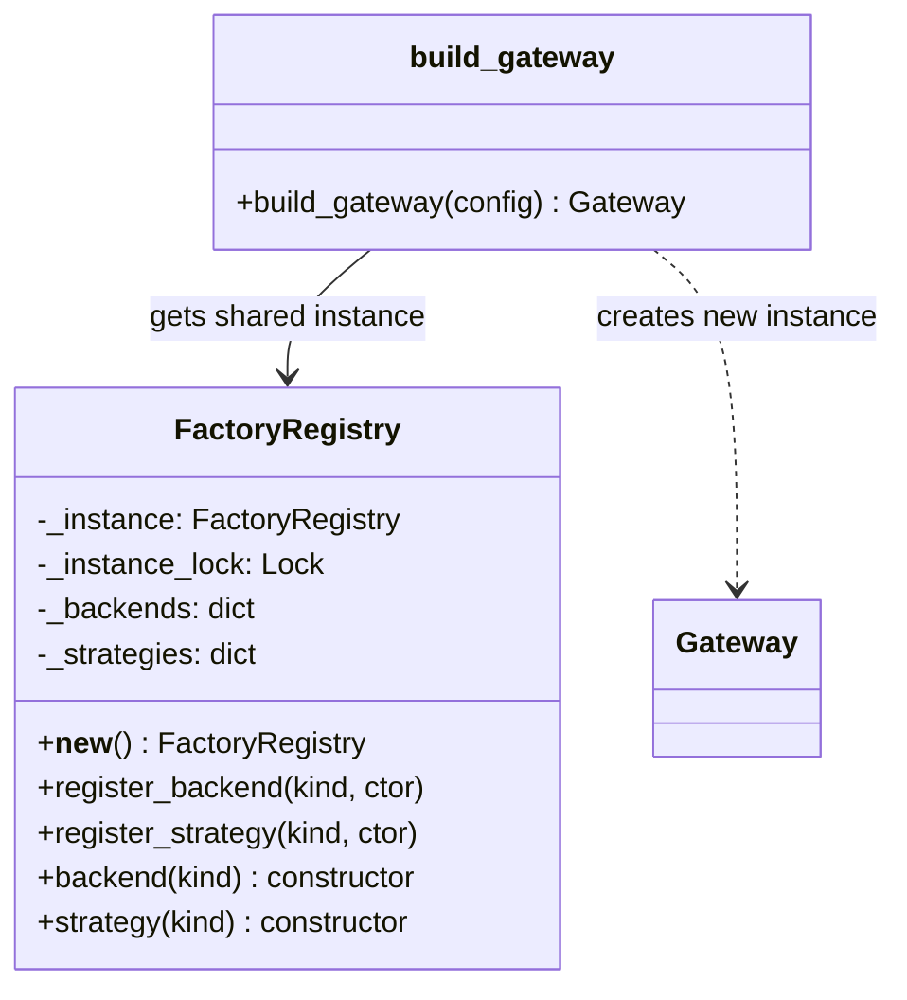
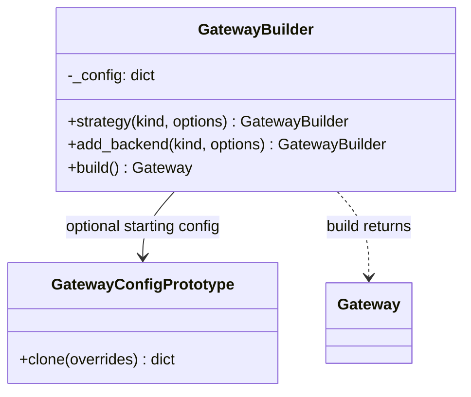
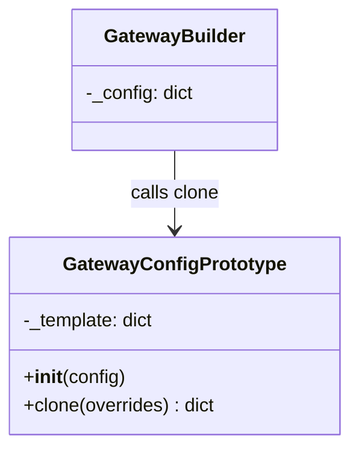
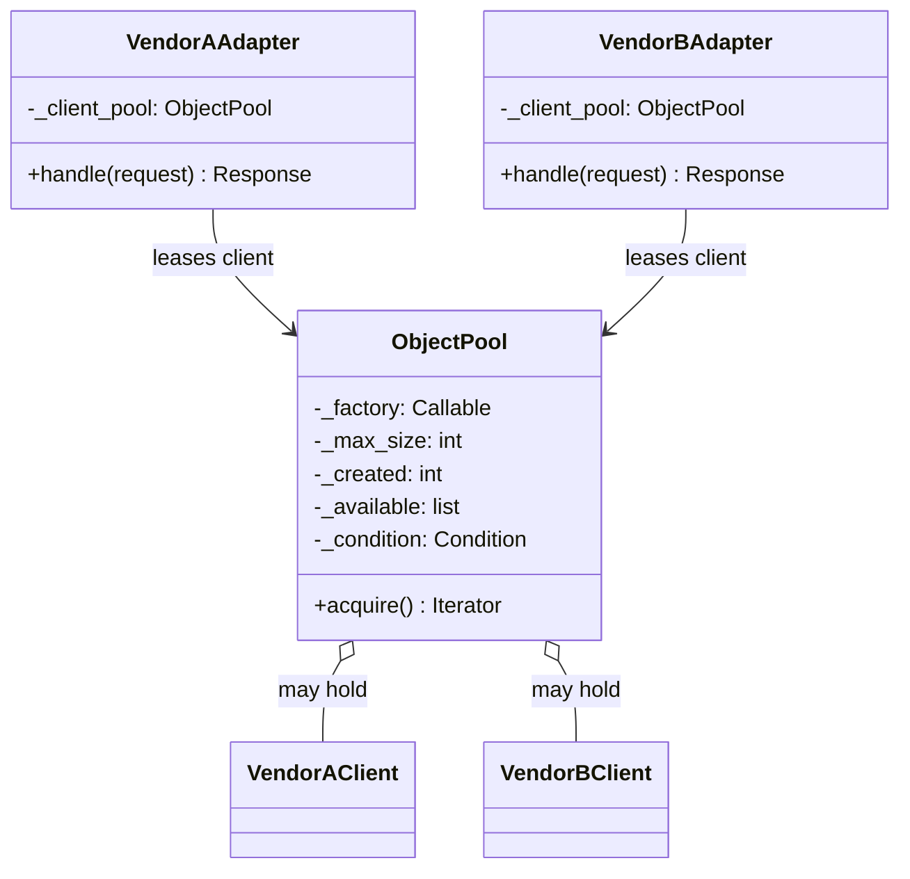
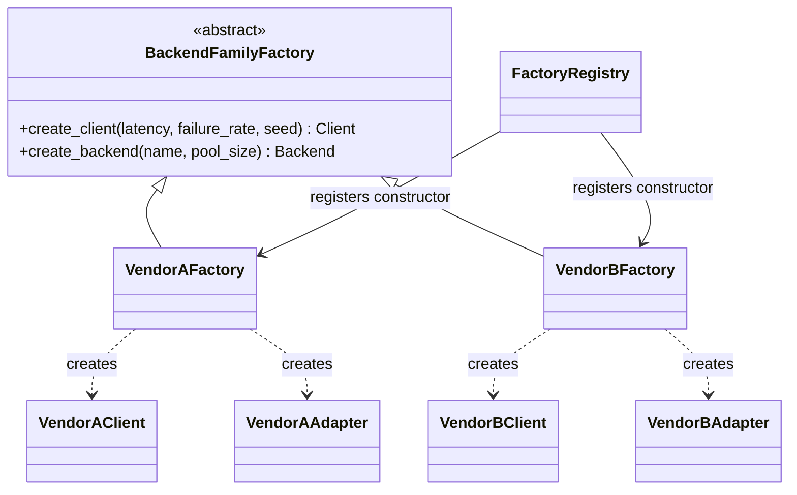

# Lab 2: Creational design patterns

Lab 2 extends the simulated AI inference gateway from Lab 1 with five creational patterns. The request path and the `Backend` and `BalancingStrategy` contracts stay the same. The new code organizes component creation and reuse.

## Patterns implemented

| Pattern | Implementation | Purpose |
|---|---|---|
| Singleton | `FactoryRegistry` in `gateway/factory.py` | Shares one process-wide set of backend and strategy constructors. Registration and lookup are protected by a lock. |
| Builder | `GatewayBuilder` in `gateway/creational.py` | Builds a gateway configuration step by step, then delegates construction to `build_gateway`. |
| Prototype | `GatewayConfigPrototype` in `gateway/creational.py` | Deep copies a reusable configuration template so each clone can be changed independently. |
| Object Pool | `ObjectPool` in `gateway/pool.py` | Reuses a bounded number of vendor clients. A client is returned after a request, including when the request raises an error. |
| Abstract Factory | `BackendFamilyFactory`, `VendorAFactory`, `VendorBFactory` in `gateway/vendor_factories.py` | Creates matching vendor clients and backend adapters as a family. |

## Class diagrams by pattern

### 1. Singleton — `FactoryRegistry`

All calls to `FactoryRegistry()` return the same instance. The registry stores constructors, while `build_gateway` uses those constructors to create a new gateway for each configuration.



```python
from gateway import FactoryRegistry

registry_a = FactoryRegistry()
registry_b = FactoryRegistry()
assert registry_a is registry_b  # One shared constructor registry.
```

### 2. Builder — `GatewayBuilder`

The builder collects the strategy and backends through chained calls. `build()` passes the completed configuration to `build_gateway`.



```python
from gateway import GatewayBuilder

gateway = (GatewayBuilder()
           .strategy("round_robin")
           .add_backend("vendor_a", name="primary", latency_s=0.01)
           .add_backend("vendor_b", name="secondary", latency_s=0.03)
           .build())
```

### 3. Prototype — `GatewayConfigPrototype`

The prototype keeps a private configuration template. `clone()` returns a deep copy, so changes to one clone do not affect later clones.



```python
from gateway import GatewayConfigPrototype

prototype = GatewayConfigPrototype({
    "strategy": "round_robin",
    "backends": [{"type": "vendor_a", "name": "primary"}],
})
config_a = prototype.clone()
config_b = prototype.clone(strategy="least_connections")
config_a["backends"][0]["name"] = "custom"
assert config_b["backends"][0]["name"] == "primary"
```

### 4. Object Pool — `ObjectPool`

An adapter leases one client for each request. The pool creates clients lazily up to `max_size`, waits when all are busy, and returns each client after use, even when an error occurs.



```python
from gateway import Request, build_gateway

gateway = build_gateway({
    "strategy": "round_robin",
    "backends": [{"type": "vendor_a", "pool_size": 2}],
})
response = gateway.handle(Request("hello"))
# The adapter leases a client from its pool and returns it after handle().
```

### 5. Abstract Factory — vendor families

`BackendFamilyFactory` defines creation methods. Each concrete factory creates a matching vendor client and adapter; the built-in registry entries call these factories.



```python
from gateway import VendorAFactory, VendorBFactory

backend_a = VendorAFactory().create_backend(name="a", latency_s=0)
backend_b = VendorBFactory().create_backend(name="b", latency_s=0)
# Each factory creates an adapter with its matching vendor client.
```

## How they work together

A builder can start with a prototype. Calling `build()` passes the resulting configuration to `build_gateway`. The singleton registry resolves the configured strategy and backend types. A built-in backend type calls its vendor abstract factory, which creates the matching client and adapter. If `pool_size` is set, the factory supplies the adapter with a client pool.

## Example

```python
from gateway import GatewayBuilder, GatewayConfigPrototype, Request

base = GatewayConfigPrototype({
    "strategy": "round_robin",
    "backends": [{"type": "vendor_a", "name": "fast-a", "latency_s": 0.01}],
})

gateway = (GatewayBuilder(base)
           .add_backend("vendor_b", name="pooled-b", latency_s=0.03, pool_size=4)
           .build())
response = gateway.handle(Request("hello"))
print(response.backend, response.text)

# The template remains unchanged; this is a separate configuration.
other_config = base.clone(strategy="least_connections")
```

`pool_size` is optional and must be positive. Without it, the adapter keeps one client as in Lab 1. A pool creates clients lazily up to its limit; when all are leased, another request waits until one is returned. The simulated clients are cheap, so pooling here demonstrates controlled reuse rather than a measured speed improvement.

## Verification

Run the full test suite from the repository root:

```sh
python3 -m unittest discover -s tests -v
```

`tests/test_creational.py` checks singleton identity across threads, builder construction, prototype isolation, pool reuse and its concurrency limit, release after errors, vendor factory pairings, and concurrent requests through a pooled backend. The Lab 1 tests also run to check that the original configuration API and request behavior still work.
