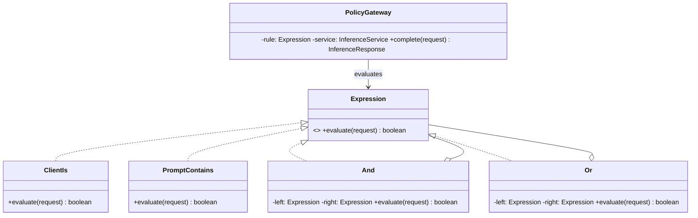
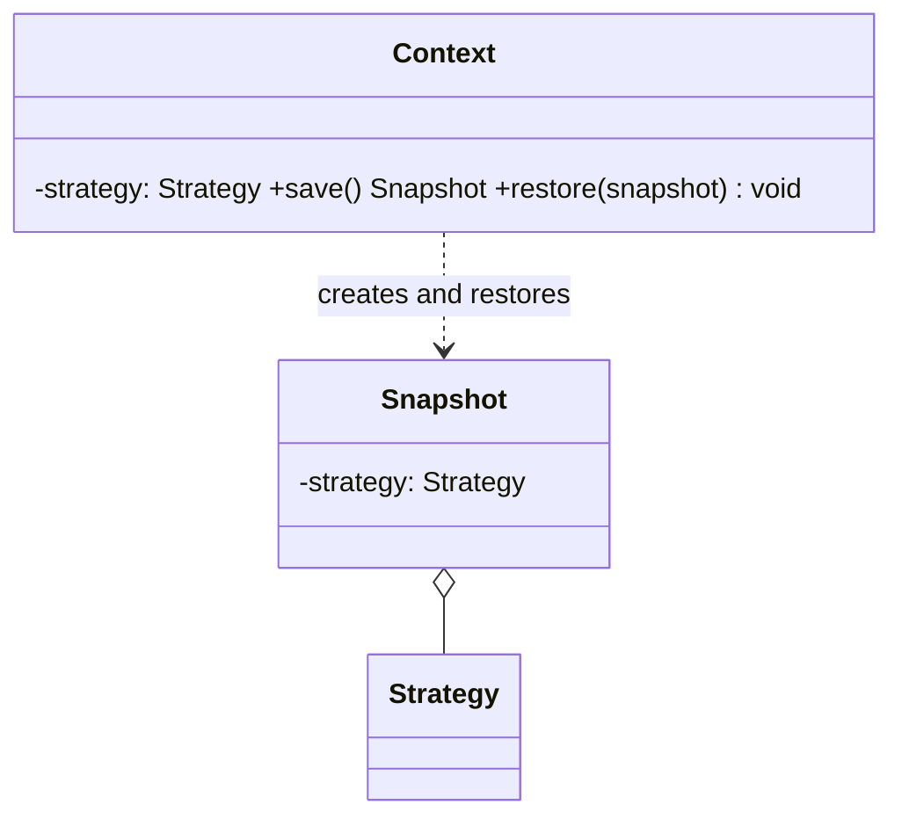
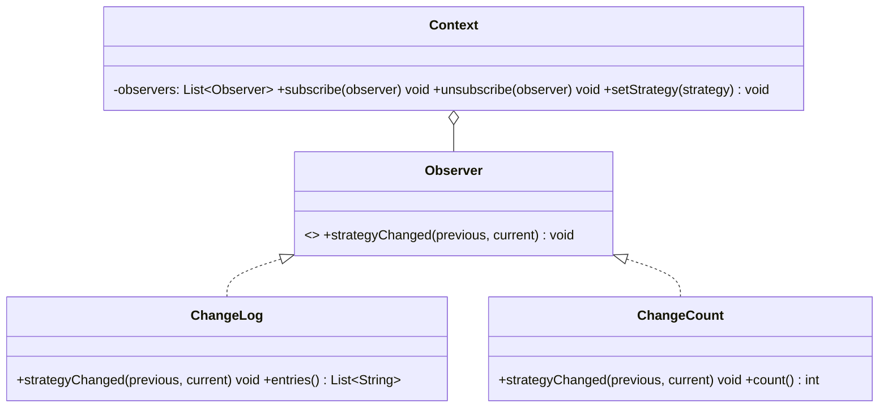
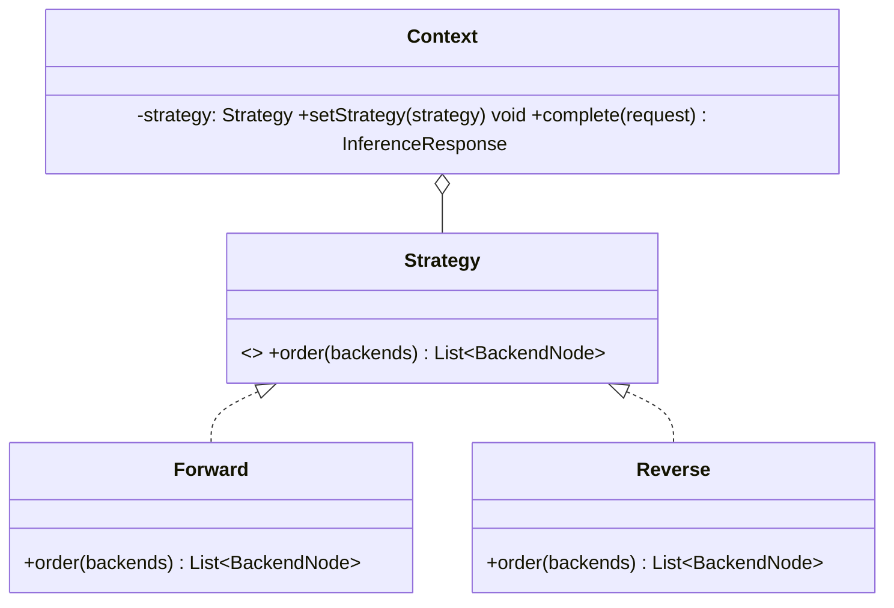
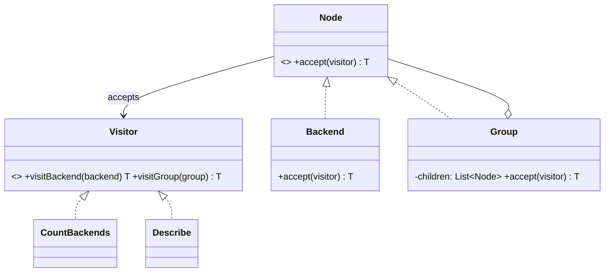

# Behavioral design patterns — AI inference gateway

## Domain and scope

The Java gateway receives a client's prompt and sends it to a simulated backend. This extension implements the five selected behavioral patterns: **Interpreter, Memento, Observer, Strategy, and Visitor**. It reuses `InferenceService`, `InferenceRequest`, `InferenceResponse`, and `SimulatedBackend` from the structural lab. The other six behavioral patterns are studied conceptually but have no implementation in this extension.

The integrated path is `PolicyGateway (Interpreter) → Routing.Context (Strategy) → SimulatedBackend`. Changing the strategy notifies observers; a memento restores the previous strategy. Visitor produces reports over a route plan built from the same backend names. The client depends on `InferenceService`, `Interpreter.Expression`, `Routing.Strategy`, and `RoutingEvents.Observer` abstractions.

Run from `lab3/`:

```sh
mvn clean test
mvn exec:java -Dexec.mainClass=gateway.client.BehavioralDemo
```

## 1. Interpreter

**Problem and fit.** Client access may depend on several small rules. `ClientIs` and `PromptContains` are terminal expressions; `And` and `Or` compose them. `PolicyGateway` evaluates an `Expression` before delegating to an `InferenceService`. Adding a new expression requires a new class that implements the interface, with no change to existing expression classes. Sources: [Interpreter.java](src/main/java/gateway/behavioral/Interpreter.java), [PolicyGateway.java](src/main/java/gateway/behavioral/PolicyGateway.java).



```java
public record And(Expression left, Expression right) implements Expression {
    public And { Objects.requireNonNull(left); Objects.requireNonNull(right); }
    @Override public boolean evaluate(InferenceRequest request) {
        return left.evaluate(request) && right.evaluate(request);
    }
}
public record Or(Expression left, Expression right) implements Expression {
    public Or { Objects.requireNonNull(left); Objects.requireNonNull(right); }
    @Override public boolean evaluate(InferenceRequest request) {
        return left.evaluate(request) || right.evaluate(request);
    }
}
```

The composite expressions recursively evaluate the grammar tree. `PolicyGateway` enforces the result before routing. Tests: `interpreterCombinesTerminalExpressions`, `interpreterOrAllowsEitherBranch`, and `interpreterPolicyBlocksBackendCall`.

## 2. Memento

**Problem and fit.** An operator can save the routing choice, try a different strategy, and restore the previous choice. `Context` is the originator; its private `Snapshot` captures the strategy reference. The built-in strategies are immutable, so later context changes do not alter a saved snapshot. Source: [Routing.java](src/main/java/gateway/behavioral/Routing.java).



```java
public Strategy strategy() { return strategy; }
public Snapshot save() {
    return new Snapshot(strategy);
}
public void restore(Snapshot snapshot) { setStrategy(snapshot.strategy); }
public static final class Snapshot {
    private final Strategy strategy;
    private Snapshot(Strategy strategy) {
        this.strategy = strategy;
    }
}
```

The snapshot does not expose its saved field to clients. Restoration goes through `setStrategy`, so observers also see the restored choice. Tests: `mementoRestoresTheSavedRoutingChoice` and `mementoSurvivesLaterContextChanges`.

## 3. Observer

**Problem and fit.** Audit and metrics need to react when the routing strategy changes. `Routing.Context` is the subject; `ChangeLog` and `ChangeCount` are two concrete observers behind `RoutingEvents.Observer`. Subscribers can join or leave at runtime. Sources: [Routing.java](src/main/java/gateway/behavioral/Routing.java), [RoutingEvents.java](src/main/java/gateway/behavioral/RoutingEvents.java).



```java
public void subscribe(RoutingEvents.Observer observer) {
    observers.add(Objects.requireNonNull(observer));
}
public void unsubscribe(RoutingEvents.Observer observer) {
    observers.remove(observer);
}
public void setStrategy(Strategy strategy) {
    Strategy next = Objects.requireNonNull(strategy);
    if (this.strategy == next) return;
    String previous = this.strategy.getClass().getSimpleName();
    this.strategy = next;
    for (RoutingEvents.Observer observer : List.copyOf(observers)) {
        observer.strategyChanged(previous, next.getClass().getSimpleName());
    }
}
```

The subject calls only the observer interface. Copying the subscriber list permits subscription changes during notification without modifying the active traversal. Tests: `observerNotifiesTwoSubscribers` and `observerCanUnsubscribeAtRuntime`.

## 4. Strategy

**Problem and fit.** The gateway may prefer the configured backend order or the reverse order. `Forward` and `Reverse` implement the same `Strategy` interface. `Context` accepts a strategy object at construction and can replace it at runtime. A new ordering algorithm can be added as another implementation. Source: [Routing.java](src/main/java/gateway/behavioral/Routing.java).



```java
public interface Strategy {
    List<BackendNode> order(List<BackendNode> backends);
}
public static final class Forward implements Strategy {
    @Override public List<BackendNode> order(List<BackendNode> backends) {
        return List.copyOf(backends);
    }
}
public static final class Reverse implements Strategy {
    @Override public List<BackendNode> order(List<BackendNode> backends) {
        var copy = new ArrayList<>(backends);
        Collections.reverse(copy);
        return copy;
    }
}
```

The context asks the selected strategy for candidate order, then tries backends in that order. Tests: `strategyCanBeSwappedAtRuntime` and `strategyFallsBackInItsChosenOrder`.

## 5. Visitor

**Problem and fit.** A stable route plan has backend leaves and groups. Reporting operations vary: `CountBackends` counts leaves, while `Describe` formats the tree. Each plan node calls the appropriate visitor method through `accept`, giving double dispatch without type checks. New reporting operations need new visitor classes rather than edits to plan nodes. Source: [RoutePlan.java](src/main/java/gateway/behavioral/RoutePlan.java).



```java
public interface Node { <T> T accept(Visitor<T> visitor); }
public interface Visitor<T> {
    T visitBackend(Backend backend);
    T visitGroup(Group group);
}
public record Backend(String name) implements Node {
    @Override public <T> T accept(Visitor<T> visitor) {
        return visitor.visitBackend(this);
    }
}
public record Group(String name, List<Node> children) implements Node {
    public Group { children = List.copyOf(children); }
    @Override public <T> T accept(Visitor<T> visitor) {
        return visitor.visitGroup(this);
    }
}
```

The `accept`/`visit` pair selects behavior based on both the visitor and the concrete node. Tests: `visitorCountsNestedBackends` and `visitorAddsDescriptionWithoutChangingNodes`.

## Interaction and test evidence

`integratedPolicyRoutingSnapshotAndEvents` verifies one execution path across Interpreter, Strategy, Observer, and Memento. The demo also builds a route plan from the same backend names and runs both visitors. The prior structural patterns remain available and unchanged; the behavioral routing context reuses their backend contract and leaves.

```text
BehavioralPatternsTest: 12 tests, 0 failures, 0 errors
Full Maven suite: 23 tests, 0 failures, 0 errors
```

## Conclusion

The main design challenge was making Observer useful after removing State. Strategy changes are a concrete event that both audit and metrics need, so the routing context now publishes those changes through an observer interface. If this became a concurrent gateway, strategy changes and observer notifications would need synchronization or an event queue; this teaching implementation is synchronous.
