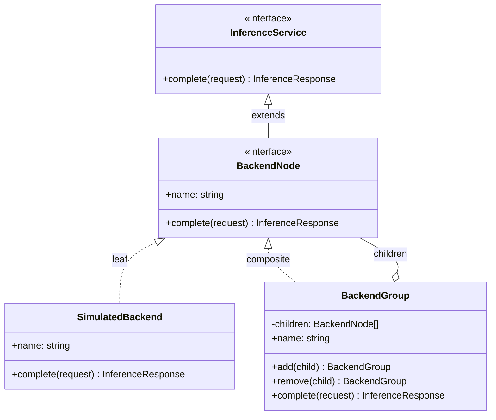
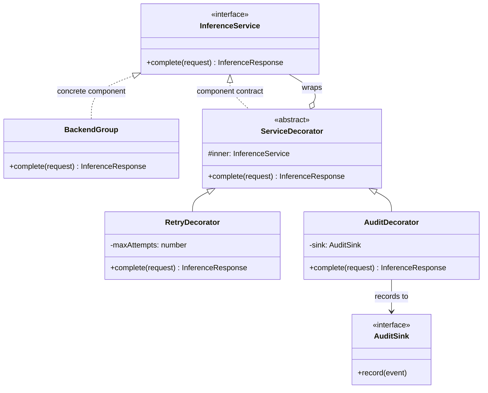
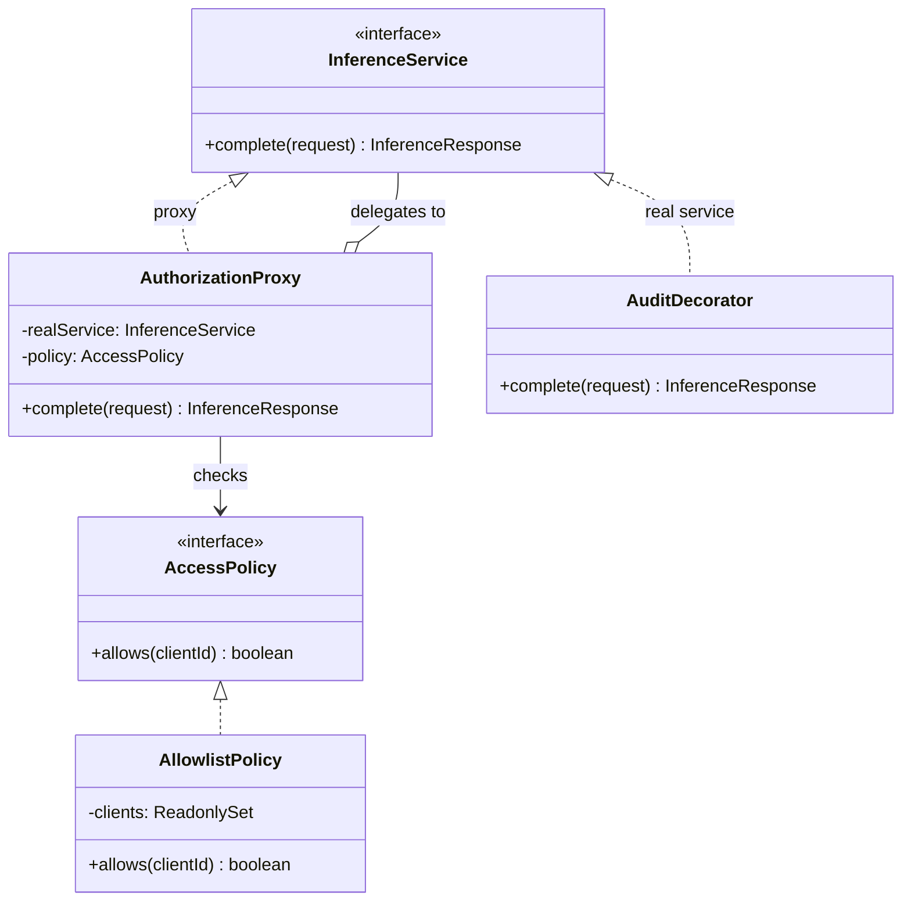

# Lab 3 report: Structural design patterns

The supplied assignment sheet calls this “Laboratory Work No. 2 — Structural Design Patterns.” This repository already uses Lab 2 for creational patterns, so this extension is named Lab 3. The sheet requires a class-based language with explicit interfaces and excludes Python; this lab is implemented in TypeScript.

## Domain

The application is a simulated AI inference gateway. Clients send a prompt and client ID. A gateway checks access, records outcomes, retries temporary failures, and selects an available backend from a group. No real vendor API or model is called. A [Builder](src/creation/gateway-pipeline-builder.ts) assembles these structural objects, reusing the creational pattern from the earlier lab.

One execution path is:

```text
Client → AuthorizationProxy → AuditDecorator → RetryDecorator
       → BackendGroup → SimulatedBackend
```

All layers expose `InferenceService.complete(request)`. The `BackendNode` component interface extends that contract for composite leaves and groups. The composition root (`demo.ts` and the Builder) names concrete classes; clients use the shared service interface.

## 1. Composite

**Problem and fit.** A gateway may have individual providers and regional groups of providers. Both must accept the same request. `BackendGroup` tries children in order and can contain another group; `SimulatedBackend` is a leaf.



Source: [backend-group.ts](src/patterns/composite/backend-group.ts), [backend-node.ts](src/patterns/composite/backend-node.ts), [simulated-backend.ts](src/patterns/composite/simulated-backend.ts).

```typescript
  add(child: BackendNode): this {
    if (child === this) throw new Error("a group cannot contain itself");
    this.children.push(child);
    return this;
  }

  remove(child: BackendNode): this {
    const index = this.children.indexOf(child);
    if (index >= 0) this.children.splice(index, 1);
    return this;
  }

  complete(request: InferenceRequest): InferenceResponse {
    for (const child of this.children) {
      try {
        return child.complete(request);
      } catch (error) {
        if (!(error instanceof BackendUnavailableError)) throw error;
      }
    }
    throw new BackendUnavailableError(`all backends in ${this.name} unavailable`);
  }
```

`BackendGroup` stores `BackendNode` objects, so each child may be a leaf or another group. It delegates `complete` through the common interface and falls back only on normalized availability failures.

**Tests.** `Composite: leaf and group expose the same complete contract` compares their responses. `Composite: nested groups fall back to another child` proves nested composition and fallback. `Composite: removing a child and exhausting children reports unavailability` covers the empty group.

## 2. Decorator

**Problem and fit.** Retry and audit behavior should be independently attachable to any inference service. `ServiceDecorator` is a base wrapper; `RetryDecorator` and `AuditDecorator` are concrete wrappers. They can be stacked at runtime.



Source: [service-decorator.ts](src/patterns/decorator/service-decorator.ts), [retry-decorator.ts](src/patterns/decorator/retry-decorator.ts), [audit-decorator.ts](src/patterns/decorator/audit-decorator.ts).

```typescript
export class RetryDecorator extends ServiceDecorator {
  constructor(inner: InferenceService, private readonly maxAttempts: number) {
    super(inner);
    if (!Number.isInteger(maxAttempts) || maxAttempts < 1) {
      throw new RangeError("maxAttempts must be a positive integer");
    }
  }

  override complete(request: InferenceRequest): InferenceResponse {
    for (let attempt = 1; attempt <= this.maxAttempts; attempt++) {
      try {
        return this.inner.complete(request);
      } catch (error) {
        if (!(error instanceof BackendUnavailableError) || attempt === this.maxAttempts) {
          throw error;
        }
      }
    }
    throw new Error("unreachable retry state");
  }
}
```

The decorator holds an `InferenceService` and calls it through the same interface. Retry adds behavior around the call; audit is another wrapper that records success or failure without changing the response.

**Tests.** `Decorator: retry wrapper succeeds after temporary failure` checks the number of attempts. `Decorator: audit wrapper records success and failure without changing the response` checks events and output. `Decorator: audit and retry can be stacked in either order` exercises both wrapper orders.

## 3. Proxy

**Problem and fit.** Unauthorized clients must be stopped before any backend call. `AuthorizationProxy` has the same interface as the real service and delegates only after an `AccessPolicy` allows the client. The concrete `AllowlistPolicy` can be replaced by a new policy class without changing the proxy.



Source: [authorization-proxy.ts](src/patterns/proxy/authorization-proxy.ts).

```typescript
export class AuthorizationProxy implements InferenceService {
  constructor(
    private readonly realService: InferenceService,
    private readonly policy: AccessPolicy,
  ) {}

  complete(request: InferenceRequest): InferenceResponse {
    if (!this.policy.allows(request.clientId)) {
      throw new AccessDeniedError(request.clientId);
    }
    return this.realService.complete(request);
  }
}
```

The proxy implements `InferenceService` and stores another `InferenceService`. Its access check runs before delegation; an authorized call returns the real service's exact response.

**Tests.** `Proxy: unauthorized calls never reach the real service` verifies zero backend calls. `Proxy: authorized calls return the real service response unchanged` checks object identity and one delegation. `Proxy: a new access policy works without changing the proxy` proves extension through the interface.

## Pattern interaction and extension

The [demo](src/client/demo.ts) builds `Proxy → AuditDecorator → RetryDecorator → Composite → Leaf` and prints both allowed and denied requests. `Integration: Builder connects Proxy, Decorators, and Composite in one path` checks the same flow, including a retry after both leaves initially fail. `Integration: Builder accepts a new decorator without modification` adds an uppercase wrapper by supplying a new class to the Builder. A new backend implements `BackendNode`; a new access rule implements `AccessPolicy`.

## Test evidence

Run `npm ci && npm test` from `lab3/`. The actual test run produced:

```text
✔ Composite: leaf and group expose the same complete contract
✔ Composite: nested groups fall back to another child
✔ Composite: removing a child and exhausting children reports unavailability
✔ Decorator: retry wrapper succeeds after temporary failure
✔ Decorator: audit wrapper records success and failure without changing the response
✔ Decorator: audit and retry can be stacked in either order
✔ Proxy: unauthorized calls never reach the real service
✔ Proxy: authorized calls return the real service response unchanged
✔ Proxy: a new access policy works without changing the proxy
✔ Integration: Builder connects Proxy, Decorators, and Composite in one path
✔ Integration: Builder accepts a new decorator without modification
ℹ tests 11
ℹ pass 11
ℹ fail 0
```

## Other structural patterns studied

| Pattern | What it would do here | Why it was not selected |
|---|---|---|
| Adapter | Convert an incompatible external vendor SDK to `InferenceService`. | The simulated vendors in this project were written here; the assignment requires an independently supplied adaptee for Adapter. |
| Bridge | Vary request routing and vendor transport implementations independently. | The existing domain does not yet have two independently changing implementation hierarchies. |
| Facade | Expose one simple entry point to the gateway subsystem. | The earlier Python `Gateway.handle` already demonstrates this idea. |
| Flyweight | Share immutable model metadata across many small request objects. | The current demo has too few fine-grained objects for a useful memory saving. |

## Conclusions

The hardest part was making the patterns cooperate through one contract while preserving each pattern's distinct role. The composite performs backend fallback, the retry decorator repeats a failed group call, and the proxy blocks access before either runs. I would next add asynchronous backend calls and cancellation; that would require an async `InferenceService` interface and careful retry timing. The current implementation remains synchronous to keep the structural relationships easy to inspect and defend.
