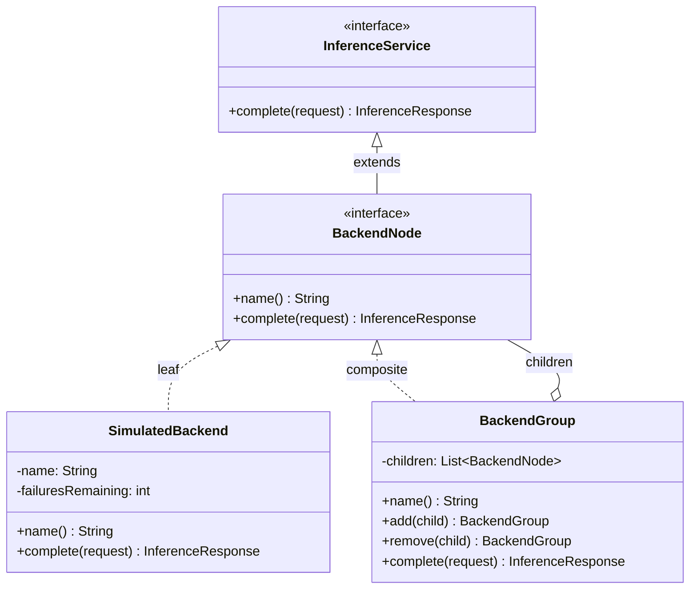
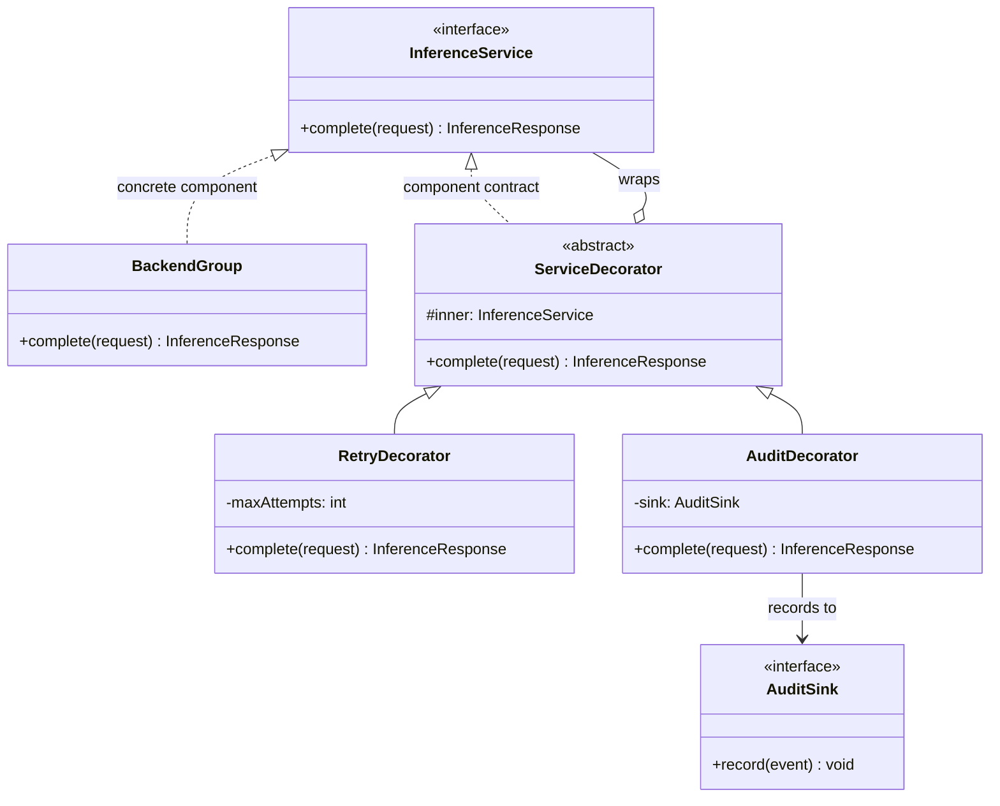

# Lab 3 report: Structural design patterns

The supplied assignment calls this “Laboratory Work No. 2 — Structural Design Patterns.” This repository already uses Lab 2 for creational patterns, so this extension is named Lab 3. The assignment requires a class-based language with explicit interfaces; this module uses Java 17.

## Domain

The application is a simulated AI inference gateway. Clients send a prompt and client ID. The gateway checks access, records outcomes, retries temporary failures, and selects an available backend from a group. No real model or vendor API is called. [GatewayPipelineBuilder](src/main/java/gateway/creation/GatewayPipelineBuilder.java) reuses the creational Builder idea from the previous lab to assemble the structural objects.

One execution path is:

```text
Client → AuthorizationProxy → AuditDecorator → RetryDecorator
       → BackendGroup → SimulatedBackend
```

All layers implement `InferenceService.complete(InferenceRequest)`. The `BackendNode` component interface extends it for composite leaves and groups. The composition root ([Demo.java](src/main/java/gateway/client/Demo.java) and the Builder) names concrete classes; client calls use the shared service interface.

## 1. Composite

**Problem and fit.** A gateway can have individual providers and regional groups of providers. Both must accept the same request. `BackendGroup` tries children in order and can contain another group; `SimulatedBackend` is a leaf.



Source: [BackendGroup.java](src/main/java/gateway/patterns/composite/BackendGroup.java), [BackendNode.java](src/main/java/gateway/patterns/composite/BackendNode.java), [SimulatedBackend.java](src/main/java/gateway/patterns/composite/SimulatedBackend.java).

```java
public BackendGroup add(BackendNode child) {
    if (child == this) throw new IllegalArgumentException("a group cannot contain itself");
    children.add(child);
    return this;
}

@Override
public InferenceResponse complete(InferenceRequest request) {
    for (BackendNode child : children) {
        try {
            return child.complete(request);
        } catch (BackendUnavailableException ignored) {
            // Try the next child; unexpected errors propagate.
        }
    }
    throw new BackendUnavailableException("all backends in " + name + " unavailable");
}
```

`BackendGroup` stores `BackendNode` objects, so each child can be a leaf or another group. It delegates `complete` through the common interface and falls back only on normalized availability failures.

**Tests.** `CompositeTest.leafAndGroupShareCompleteContract` compares their responses. `CompositeTest.nestedGroupsFallBackToAnotherChild` proves nested composition and fallback. `CompositeTest.removedChildLeavesGroupUnavailable` covers the empty group.

## 2. Decorator

**Problem and fit.** Retry and audit behavior should be independently attachable to any inference service. `ServiceDecorator` is the base wrapper; `RetryDecorator` and `AuditDecorator` are concrete wrappers. They can be stacked at runtime.



Source: [ServiceDecorator.java](src/main/java/gateway/patterns/decorator/ServiceDecorator.java), [RetryDecorator.java](src/main/java/gateway/patterns/decorator/RetryDecorator.java), [AuditDecorator.java](src/main/java/gateway/patterns/decorator/AuditDecorator.java).

```java
public final class RetryDecorator extends ServiceDecorator {
    private final int maxAttempts;

    public RetryDecorator(InferenceService inner, int maxAttempts) {
        super(inner);
        if (maxAttempts < 1) throw new IllegalArgumentException("maxAttempts must be positive");
        this.maxAttempts = maxAttempts;
    }

    @Override
    public InferenceResponse complete(InferenceRequest request) {
        for (int attempt = 1; ; attempt++) {
            try {
                return inner.complete(request);
            } catch (BackendUnavailableException error) {
                if (attempt >= maxAttempts) throw error;
            }
        }
    }
}
```

The decorator stores an `InferenceService` and calls it through the same interface. Retry adds behavior around that call; audit is another wrapper that records success or failure without changing the response.

**Tests.** `DecoratorTest.retrySucceedsAfterTemporaryFailure` checks the number of attempts. `DecoratorTest.auditRecordsFailureAndSuccessWithoutChangingResponse` checks events and output. `DecoratorTest.decoratorsCanBeStackedInEitherOrder` exercises both wrapper orders.

## 3. Proxy

**Problem and fit.** Unauthorized clients must be stopped before any backend call. `AuthorizationProxy` implements the same interface as the real service and delegates only after an `AccessPolicy` allows the client. `AllowlistPolicy` can be replaced with a new policy class without changing the proxy.


Source: [AuthorizationProxy.java](src/main/java/gateway/patterns/proxy/AuthorizationProxy.java).

```java
public final class AuthorizationProxy implements InferenceService {
    private final InferenceService realService;
    private final AccessPolicy policy;

    public AuthorizationProxy(InferenceService realService, AccessPolicy policy) {
        this.realService = realService;
        this.policy = policy;
    }

    @Override
    public InferenceResponse complete(InferenceRequest request) {
        if (!policy.allows(request.clientId())) {
            throw new AccessDeniedException(request.clientId());
        }
        return realService.complete(request);
    }
}
```

The proxy implements `InferenceService` and stores another `InferenceService`. Its access check runs before delegation; an authorized call returns the real service's exact response.

**Tests.** `ProxyTest.unauthorizedCallNeverReachesRealService` verifies zero backend calls. `ProxyTest.authorizedCallReturnsRealResponseUnchanged` checks object identity and one delegation. `ProxyTest.newPolicyWorksWithoutChangingProxy` proves extension through the interface.

## Pattern interaction and extension

The [demo](src/main/java/gateway/client/Demo.java) builds `Proxy → AuditDecorator → RetryDecorator → Composite → Leaf` and prints both allowed and denied requests. `IntegrationTest.builderConnectsProxyDecoratorsAndCompositeInOnePath` checks the same flow, including a retry after both leaves initially fail. `IntegrationTest.builderAcceptsNewDecoratorWithoutModification` adds an uppercase wrapper by supplying a new class to the Builder. A new backend implements `BackendNode`; a new access rule implements `AccessPolicy`.

## Test evidence

Run `mvn test` from `lab3/`. Maven Surefire reported:

```text
Tests run: 3, Failures: 0, Errors: 0, Skipped: 0 -- gateway.CompositeTest
Tests run: 3, Failures: 0, Errors: 0, Skipped: 0 -- gateway.DecoratorTest
Tests run: 3, Failures: 0, Errors: 0, Skipped: 0 -- gateway.ProxyTest
Tests run: 2, Failures: 0, Errors: 0, Skipped: 0 -- gateway.IntegrationTest
Total: 11 tests, 0 failures, 0 errors
```

## Other structural patterns studied

| Pattern | What it would do here | Why it was not selected |
|---|---|---|
| Adapter | Convert an incompatible external vendor SDK to `InferenceService`. | The simulated vendors were written here; the assignment requires an independently supplied adaptee for Adapter. |
| Bridge | Vary routing and vendor transport independently. | The domain does not yet have two independently changing implementation hierarchies. |
| Facade | Expose one simple entry point to the gateway subsystem. | The earlier Python `Gateway.handle` already demonstrates this idea. |
| Flyweight | Share immutable model metadata across many small requests. | The demo has too few fine-grained objects for a useful memory saving. |

## Conclusions

The hardest part was making all patterns cooperate through one contract while preserving their roles. The composite performs backend fallback, the retry decorator repeats a failed group call, and the proxy blocks access before either runs. I would next add asynchronous backend calls and cancellation; that would require an asynchronous service interface and careful retry timing. This implementation stays synchronous so its structural relationships are easy to inspect and defend.
