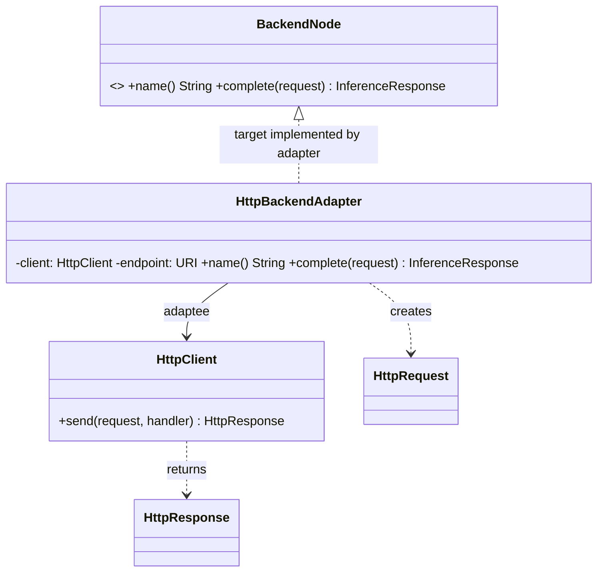
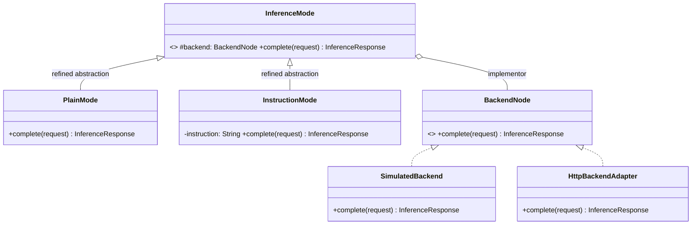
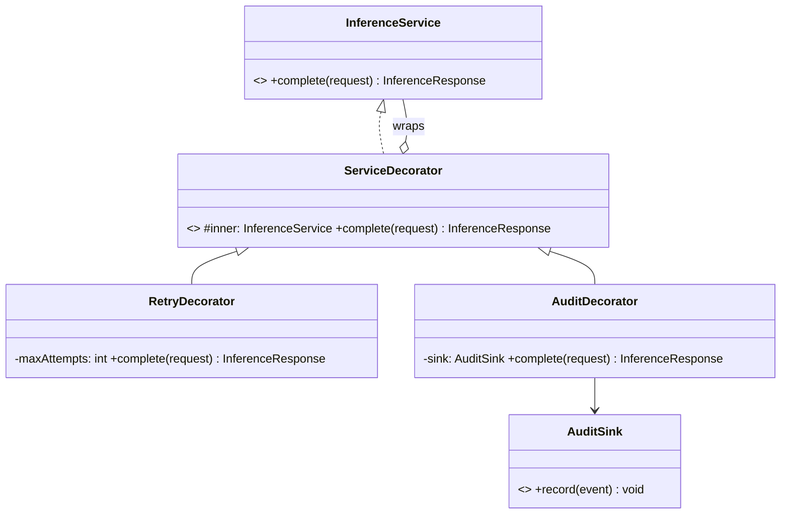
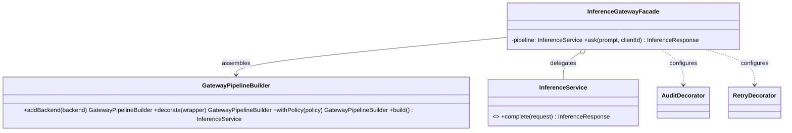

# Laboratory Work No. 2 — Structural Design Patterns

## Domain and selection

The project is a simulated AI inference gateway. Clients submit a prompt and client ID; a backend returns an `InferenceResponse`. This laboratory selects four structural patterns: **Adapter, Bridge, Decorator, and Facade**. The Java module also contains earlier Composite and Proxy code, which the existing builder uses as infrastructure, but those are not among the four selected patterns in this report.

The integrated demonstration follows this path:

```text
Client → InferenceGatewayFacade → AuditDecorator → RetryDecorator
       → BackendGroup → InstructionMode → HttpBackendAdapter → JDK HttpClient
```

`GatewayPipelineBuilder` reuses a creational Builder to assemble the layers. The demo's vendor is a local HTTP server, so the example is reproducible without an external model service. `HttpBackendAdapter` adapts the **JDK `java.net.http.HttpClient` public API**, which is not authored in this project. The server is only a test fixture for that API.

## 1. Adapter

**Problem and fit.** `HttpClient` accepts `HttpRequest` and returns `HttpResponse<String>`, while gateway components use `BackendNode.complete(InferenceRequest)` and `InferenceResponse`. `HttpBackendAdapter` translates both directions and normalizes transport or non-2xx failures into `BackendUnavailableException`. This is a real interface mismatch with a public API we cannot change. Source: [HttpBackendAdapter.java](src/main/java/gateway/patterns/adapter/HttpBackendAdapter.java).



```java
@Override public InferenceResponse complete(InferenceRequest request) {
    HttpRequest httpRequest = HttpRequest.newBuilder(endpoint)
        .header("Content-Type", "text/plain; charset=utf-8")
        .POST(HttpRequest.BodyPublishers.ofString(request.prompt(), StandardCharsets.UTF_8))
        .build();
    try {
        HttpResponse<String> reply = client.send(httpRequest,
            HttpResponse.BodyHandlers.ofString(StandardCharsets.UTF_8));
        if (reply.statusCode() < 200 || reply.statusCode() >= 300) {
            throw new BackendUnavailableException(name + " returned HTTP " + reply.statusCode());
        }
        return new InferenceResponse(reply.body(), name);
    } catch (InterruptedException error) {
        Thread.currentThread().interrupt();
        throw new BackendUnavailableException(name + " request interrupted");
    } catch (IOException error) {
        throw new BackendUnavailableException(name + " transport failed: " + error.getMessage());
    }
}
```

The method converts the domain request into an HTTP POST and the HTTP result back into a domain response. Tests: `adapterTranslatesRequestAndResponse` checks the actual local HTTP call and response translation; `adapterNormalizesHttpFailure` checks error translation.

## 2. Bridge

**Problem and fit.** Request preparation has two variants (`PlainMode`, `InstructionMode`), while the backend has independent variants (`SimulatedBackend`, `HttpBackendAdapter`). `InferenceMode` holds the `BackendNode` implementor interface, so each mode works with each backend without creating a subclass for every combination. Sources: [InferenceMode.java](src/main/java/gateway/patterns/bridge/InferenceMode.java), [PlainMode.java](src/main/java/gateway/patterns/bridge/PlainMode.java), [InstructionMode.java](src/main/java/gateway/patterns/bridge/InstructionMode.java).



```java
public abstract class InferenceMode implements BackendNode {
    protected final BackendNode backend;
    protected InferenceMode(BackendNode backend) {
        this.backend = Objects.requireNonNull(backend);
    }
}
public final class InstructionMode extends InferenceMode {
    private final String instruction;
    public InstructionMode(BackendNode backend, String instruction) {
        super(backend);
        this.instruction = Objects.requireNonNull(instruction);
    }
    @Override public String name() { return backend.name(); }
    @Override public InferenceResponse complete(InferenceRequest request) {
        InferenceRequest prepared = new InferenceRequest(
            instruction + "\n" + request.prompt(), request.clientId());
        return backend.complete(prepared);
    }
}
```

The mode delegates through `BackendNode`, not a concrete provider. Tests: `bridgeModesVaryWithTheSameBackend` compares both modes on a local backend; `bridgeModeWorksWithDifferentBackendImplementations` uses the same mode with local and HTTP backends.

## 3. Decorator

**Problem and fit.** Audit and retry must be independently attachable to any inference service. `ServiceDecorator` keeps the `InferenceService` interface and wraps another `InferenceService`. `RetryDecorator` retries only backend unavailability; `AuditDecorator` records the result without changing it. Source: [ServiceDecorator.java](src/main/java/gateway/patterns/decorator/ServiceDecorator.java), [RetryDecorator.java](src/main/java/gateway/patterns/decorator/RetryDecorator.java), [AuditDecorator.java](src/main/java/gateway/patterns/decorator/AuditDecorator.java).



```java
public final class RetryDecorator extends ServiceDecorator {
    private final int maxAttempts;
    public RetryDecorator(InferenceService inner, int maxAttempts) {
        super(inner);
        if (maxAttempts < 1) throw new IllegalArgumentException("maxAttempts must be positive");
        this.maxAttempts = maxAttempts;
    }
    @Override public InferenceResponse complete(InferenceRequest request) {
        for (int attempt = 1; ; attempt++) {
            try {
                return inner.complete(request);
            } catch (BackendUnavailableException error) {
                if (attempt >= maxAttempts) throw error;
            }
        }
    }
}
```

The wrapper delegates through the same interface and adds retry behavior around that call. Tests: `retrySucceedsAfterTemporaryFailure`, `auditRecordsFailureAndSuccessWithoutChangingResponse`, and `decoratorsCanBeStackedInEitherOrder` prove retry, audit, and stackability.

## 4. Facade

**Problem and fit.** A caller should submit a prompt without constructing the builder, composite group, authorization proxy, and decorators. `InferenceGatewayFacade` assembles those objects once and exposes `ask(prompt, clientId)`. It delegates work to the subsystem; backend selection and audit remain in their respective components. Source: [InferenceGatewayFacade.java](src/main/java/gateway/patterns/facade/InferenceGatewayFacade.java).



```java
public InferenceGatewayFacade(BackendNode backend, AccessPolicy policy,
                              AuditSink audit, int maxAttempts) {
    Objects.requireNonNull(backend);
    Objects.requireNonNull(policy);
    Objects.requireNonNull(audit);
    pipeline = new GatewayPipelineBuilder()
        .addBackend(backend)
        .decorate(inner -> new RetryDecorator(inner, maxAttempts))
        .decorate(inner -> new AuditDecorator(inner, audit))
        .withPolicy(policy)
        .build();
}
public InferenceResponse ask(String prompt, String clientId) {
    return pipeline.complete(new InferenceRequest(prompt, clientId));
}
```

The facade owns subsystem assembly and gives clients one entry point. Tests: `facadeBuildsRetryAndAuditInTheRightOrder` checks assembly and delegation; `facadeBlocksBeforeCallingBackend` checks access before any backend call.

## Pattern interaction and test evidence

`adapterBridgeFacadeAndDecoratorRunTogether` runs the full selected path. A local HTTP server returns 503 once and then a successful result. The `HttpBackendAdapter` converts both responses; `InstructionMode` adds the instruction; `RetryDecorator` makes a second attempt; `AuditDecorator` records a single final success; `InferenceGatewayFacade.ask` is the client's only call. The demo in [SelectedStructuralDemo.java](src/main/java/gateway/client/SelectedStructuralDemo.java) prints the same path and results.

Run from `lab3/`:

```sh
mvn clean test
mvn exec:java -Dexec.mainClass=gateway.client.SelectedStructuralDemo
```

The Java suite has 7 tests in `SelectedStructuralTest`, 3 decorator tests, 8 other structural tests, and 12 behavioral tests. Maven Surefire writes the pass log to `target/surefire-reports/`.

Verified `mvn clean test` output:

```text
gateway.SelectedStructuralTest: Tests run: 7, Failures: 0, Errors: 0
gateway.DecoratorTest: Tests run: 3, Failures: 0, Errors: 0
All tests: Tests run: 30, Failures: 0, Errors: 0
BUILD SUCCESS
```

## Conclusion

The hardest part was choosing an Adapter adaptee that was genuinely external to the project. The JDK HTTP API provides that mismatch, while a local server keeps tests deterministic. Bridge required two independently varying sides; the two request modes and two backend implementations prove those combinations. For a production gateway, I would add timeouts and structured response parsing to the HTTP adapter and make retry policy configurable by failure type.
